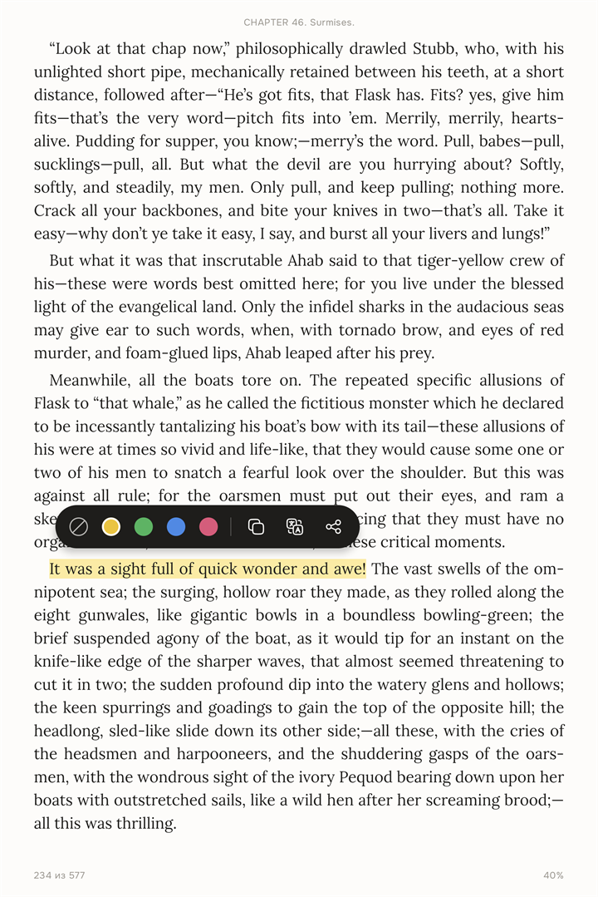
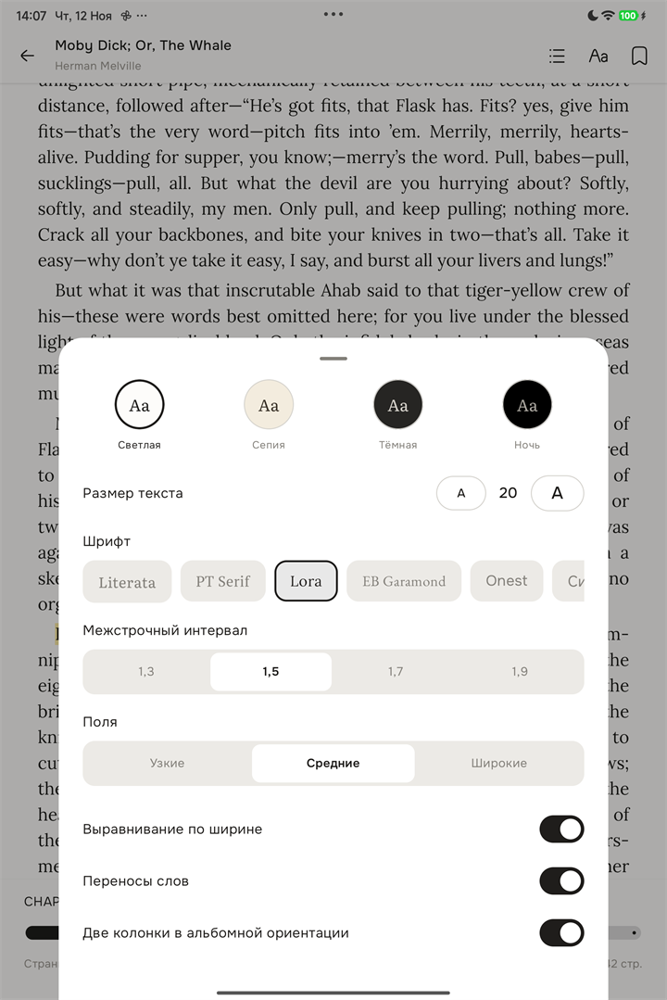
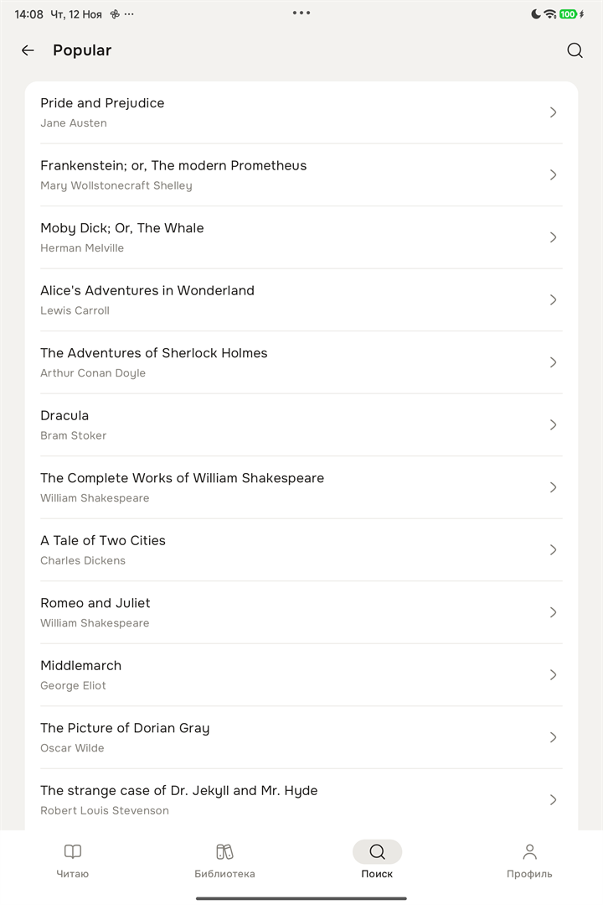
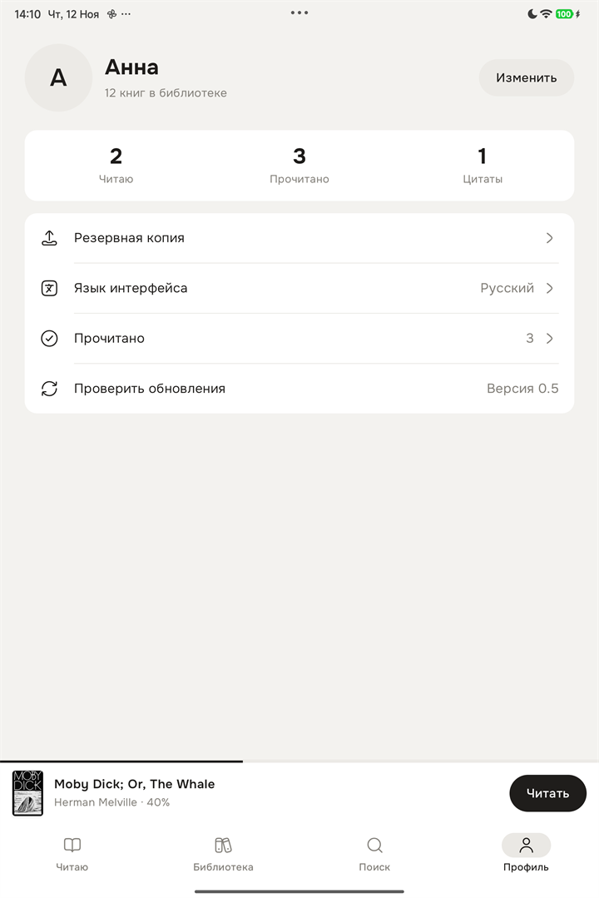

# Lexis

Спокойная читалка книг для Android — без рекламы и регистрации.
EPUB, FB2, TXT и PDF; закладки, цитаты с маркерами, перевод выделенного текста,
поиск книг в онлайн-библиотеках (OPDS), резервная копия библиотеки.
Интерфейс на русском, казахском и английском.

  
  
  

  
  

## Как установить

1. Откройте на телефоне или планшете страницу **[последнего релиза](../../releases/latest)**.
2. Скачайте файл `.apk` в разделе **Assets**.
3. Откройте скачанный файл. Android спросит, можно ли устанавливать приложения из этого источника
   (браузера или файлового менеджера), — разрешите и нажмите «Установить».

Нужен Android 11 или новее.

> **Если появится предупреждение Google Play Защиты** — это нормально для приложений не из Google Play.
> Lexis просит доступ к файлам (чтобы находить книги) и к установке обновлений, поэтому
> незнакомое приложение проверка помечает осторожно. Нажмите **«Подробнее» → «Всё равно установить»**.

## Как обновлять

В приложении: **Профиль → Проверить обновления**. Если вышла новая версия, Lexis сам её скачает
и откроет установку. Библиотека, позиции, закладки и цитаты сохраняются. Предупреждение Play Защиты
может появиться и при обновлении — так же нажмите «Подробнее» → «Всё равно установить».

---

**Қазақша.** Lexis — Android-қа арналған кітап оқу қосымшасы: жарнамасыз, тіркелусіз. Орнату үшін
[соңғы релизді](../../releases/latest) ашып, `.apk` файлын жүктеп, орнатыңыз. Google Play Қорғау ескерту көрсетсе, «Толығырақ» → «Бәрібір орнату» түймесін басыңыз.
Жаңарту: Профиль → Жаңартуларды тексеру.

**English.** Lexis is a calm, ad-free e-book reader for Android. To install, open the [latest release](../../releases/latest),
download the `.apk` file and install it. If Google Play Protect shows a warning, tap “More details” → “Install anyway”.
Updates: Profile → Check for updates.
